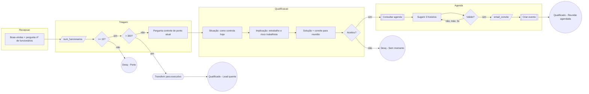

# Exemplo — Ninja Fluxograma (empresa fictícia)

> Empresa, pessoas e números inventados, só para mostrar o nível de detalhe esperado.

# Ninja Fluxograma — PontoCerto (controle de ponto para empresas)

## Fontes
Etapas e motivos de perda: export do pipeline do CRM. Perguntas e objeções: playbook do SDR (8 páginas) e
3 transcrições de calls. Agenda: informado pela gestora comercial.

## Resumo do processo
- **Antes do SDR:** o lead preenche o formulário do site (nome, empresa, WhatsApp) depois de baixar um e-book
  sobre a reforma trabalhista.
- **Depois do SDR:** qualificado vai para reunião de 30 min com um executivo de contas (rodízio entre 3 pessoas).
- **Etapas:** Recepção (linear) → Triagem (linear) → Qualificação (linear) → Agenda (linear) → Qualificado /
  Desqualificado (reativo).
- **Cortes:** menos de 15 funcionários; fora do Brasil; pessoa física.
- **Lead muito quente:** empresa com mais de 300 funcionários vai direto para humano depois da Triagem.

## Fluxo


## Gargalos e melhorias
- CRM: 41% dos negócios param em "Contato feito" sem próxima tarefa. O agente responde em segundos e já leva
  para a Triagem.
- O motivo de perda "Sem retorno" (32%) não tem pergunta que o origine: sugerimos follow-up em 24h e 72h na
  Qualificação antes de desqualificar.

## Campos
| Campo | Tipo | Etapa | Valores | Origem no CRM |
|---|---|---|---|---|
| etapa_atual | texto | todas | nome da etapa | Etapa do negócio |
| num_funcionarios | número | Triagem | inteiro | Nº de colaboradores |
| controle_atual | lista | Triagem | papel / planilha / relógio / app | — (novo) |
| dor_principal | texto | Qualificação | livre | Observações |
| email_convite | e-mail | Agenda | e-mail corporativo | E-mail |
| motivo_desqualificacao | lista | Desqualificado | porte / sem_momento / pf / exterior | Motivo de perda |
| subtipo_resultado | lista | terminais | ver círculos | — (novo) |

## Etapa pronta para colar (trecho da Triagem)
```markdown
Esta etapa confirma se a empresa tem o porte mínimo. O lead já informou nome e empresa no formulário.

### Regras gerais
- [ATUALIZAR CAMPO etapa_atual = "Triagem"] ao iniciar esta etapa.
- 1 pergunta por mensagem.

### Passos
#### Passo 1: "Registrar número de funcionários"
Regras:
- A pergunta já foi feita na Recepção. Use a resposta do lead.
Objetivo:
- [ATUALIZAR CAMPO num_funcionarios] com o número informado.
- Menos de 15 → Passo 1.1. De 15 a 300 → Passo 2. Mais de 300 → Passo 1.2.
Fallback:
- Se a resposta não for clara, diga que não entendeu e pergunte de novo, com um exemplo: "algo como 40 pessoas".

#### Passo 1.1: "Desqualificar por porte"
Regras:
- Executar apenas se num_funcionarios for menor que 15.
Objetivo:
- Envie o template "desq_porte".
- [ATUALIZAR CAMPO motivo_desqualificacao = "porte"].
- [MUDAR ETAPA → Desqualificado].
Fallback:
- Se a resposta não for clara, repita a pergunta pendente.

#### Passo 1.2: "Lead quente"
Regras:
- Executar apenas se num_funcionarios for maior que 300.
Objetivo:
- Envie o template "transbordo_executivo".
- [ATUALIZAR CAMPO subtipo_resultado = "Qualificado - Lead quente"].
- [TRANSFERIR PARA HUMANO].
Fallback:
- Se a resposta não for clara, repita a pergunta pendente.

### Templates
#### Template: "desq_porte"
Mensagem: "Obrigada por contar. Hoje o PontoCerto atende empresas a partir de 15 pessoas, então não consigo seguir agora. Se a equipe crescer, é só me chamar por aqui."

#### Template: "transbordo_executivo"
Mensagem: "Pelo tamanho da operação, vou te passar direto para um especialista. Ele te chama em instantes."
```

## Confirmar com o responsável
1. Lead com contrato vigente com concorrente: desqualifica ou agenda?
2. O agente pode citar a faixa de preço por funcionário?
