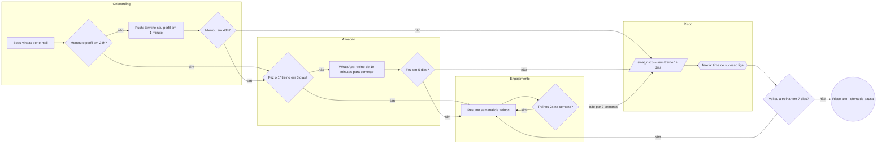

# Exemplo — Ninja Fluxograma de lifecycle (empresa fictícia)

> Empresa, números e mensagens inventados, só para mostrar o nível de detalhe esperado.

# Ninja Fluxograma — FitBox (app de treinos por assinatura)

## Fontes
Jornadas da ferramenta de automação (exportação), relatório de uso do app (planilha) e o que a gerente de CRM contou.

## Resumo do processo
- **Começa quando:** a pessoa assina o plano no site ou no app.
- **Resultado esperado:** treinar pelo menos 2 vezes por semana e renovar no fim do ciclo.
- **Participantes:** cliente, app (push), e-mail, WhatsApp, time de sucesso do cliente.
- **Momento aha:** concluir o primeiro treino em até 3 dias.

## Fluxo

## Gargalos e melhorias
- 38% não fazem o primeiro treino em 3 dias: hoje não existe nenhum toque nesse período. Sugerido o WhatsApp do A2.
- O time de sucesso só fica sabendo do risco quando a pessoa pede cancelamento. Sugerida a tarefa automática do R2.

## Régua (trecho)
| Etapa | Gatilho | Espera | Canal | Público | Objetivo | Mensagem (rascunho) | Métrica | Regra de saída |
|---|---|---|---|---|---|---|---|---|
| Onboarding | assinou | 0 | E-mail | novos assinantes | dar boas-vindas e levar ao perfil | "Bem-vinda à FitBox! Seu primeiro passo leva 1 minuto: monte seu perfil." | % perfil em 24h | montou o perfil |
| Onboarding | perfil incompleto | 24h | Push | sem perfil | completar o perfil | "Falta só um pouquinho: termine seu perfil e receba seu primeiro treino." | % perfil em 48h | montou o perfil |
| Ativação | perfil pronto, sem treino | 3 dias | WhatsApp | sem 1º treino | primeiro treino | "Que tal um treino de 10 minutos hoje? É só tocar aqui no app." | % 1º treino em 5 dias | fez o treino |
| Risco | 14 dias sem treino | 0 | Tarefa interna | em risco | conversa humana | (roteiro da ligação) | % que volta em 7 dias | voltou a treinar |

## Campos
| Campo | Tipo | Etapa | Valores | Origem |
|---|---|---|---|---|
| etapa_atual | lista | todas | onboarding / ativacao / engajamento / risco / perdido | ferramenta de automação |
| perfil_completo | sim/não | Onboarding | | app |
| data_primeiro_treino | data | Ativação | | app |
| treinos_semana | número | Engajamento | | app |
| sinal_risco | lista | Risco | sem_treino_14d / pagamento_falhou | ferramenta de automação |

## Confirmar com o responsável
1. Existe opção de pausar a assinatura?
2. Qual o limite de mensagens por semana somando todas as réguas?
