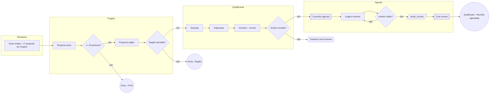

# Destinos do quadro e convenções visuais

## Convenções (iguais em todos os destinos)
| Elemento | Forma | Cor sugerida | Mermaid |
|---|---|---|---|
| Etapa | Frame / container com o nome | fundo neutro claro | `subgraph` |
| Mensagem ou pergunta | Retângulo | branco, borda azul | `[texto]` |
| Decisão | Losango | amarelo | `{texto?}` |
| Atualizar campo | Paralelogramo | lilás | `[/campo = valor/]` |
| Integração (agenda, CRM, webhook) | Retângulo com borda dupla | cinza | `[[texto]]` |
| Transferir para humano / encerrar | Hexágono | laranja | `{{texto}}` |
| Resultado: Qualificado | Círculo | verde | `((texto))` |
| Resultado: Desqualificado (um por motivo) | Círculo | vermelho | `((texto))` |
| Ponto a confirmar / gargalo | Nota adesiva | amarelo claro | `%% texto` |

Layout:
- Processo com várias áreas ou canais: uma **raia** (faixa horizontal) por participante (cliente, time, sistema) ou por canal (e-mail, WhatsApp, push). No Mermaid, use um `subgraph` por raia.
- Espera ou prazo: forma de relógio/nota com o tempo escrito ("espera 24h").
- Da esquerda para a direita, na ordem do funil. Caminho feliz em linha reta no alto.
- Desvios e desqualificações descem a partir do ponto que os originou.
- Etapas reativas (sem ordem fixa): um assunto por coluna, de cima para baixo.
- Um círculo de desqualificação por motivo, perto da decisão que o gera.
- Espaço generoso entre frames (pelo menos a largura de um frame).
- IDs curtos e estáveis: `R1`, `T1`, `Q1`, `A1`, `DESQ_PORTE`, `OK_REUNIAO`. Coloque o ID no canto da forma: é ele
  que liga o quadro ao texto do agente.
- Legenda das cores num canto do quadro.

## Miro
Com o conector do Miro ligado no Claude:
1. Crie um quadro novo com o nome "[Empresa] — Processo comercial — v1" (ou use o que a pessoa indicar).
2. Siga as instruções do próprio conector para desenhar (ele tem um guia de formato; leia antes).
3. Um frame por etapa, formas dentro, conectores com rótulo nas saídas de cada losango ("sim", "não", "< 20").
4. Notas amarelas para "Confirmar" e para gargalos com números (ex.: "só 18% passam da Triagem").
5. Devolva o link do quadro.
Sem conector: gere draw.io XML ou Mermaid. O Miro importa diagramas do draw.io e aceita colar Mermaid pelo app de
diagramas.

## FigJam
Com o conector do Figma ligado: gere o diagrama com a ferramenta de diagramas do conector, seguindo as mesmas
convenções, e devolva o link.

## Mermaid
Sempre entregue, mesmo quando o quadro foi criado no Miro ou FigJam: é a versão em texto, fácil de versionar.
Abre em mermaid.live, GitHub, Notion e Obsidian.

Valide a sintaxe antes de entregar quando houver Node: `npx -y @mermaid-js/mermaid-cli -i fluxo.mmd -o fluxo.png`.

## draw.io (diagrams.net)
Gere um arquivo `.drawio` (XML) com as mesmas formas e cores; abre no draw.io, no Lucid e pode ser importado no Miro.
Use `swimlane` para as etapas, `rhombus` para decisões, `ellipse` para resultados, `parallelogram` para campos.
