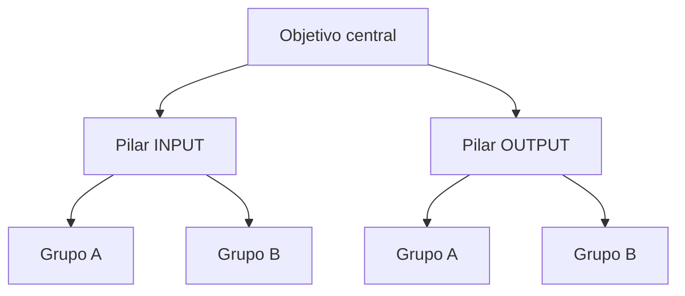

# Árvore de objetivos, OKR da área e OKR por pessoa

## Árvore de objetivos
```
                 Objetivo central (ex.: maximizar a receita de CRM)
                 KPI de input + KPI de output
                 /                                   \
     Pilar INPUT (ex.: WAU de CRM)          Pilar OUTPUT (ex.: LTV)
     objetivo + KRs                          objetivo + KRs
       /     |     \                           /     |     \
   Grupo A Grupo B Grupo C                 Grupo A Grupo B Grupo C
   (canal, segmento, produto...)           (recompra, clube, categoria...)
   objetivo + KRs em cada um                objetivo + KRs em cada um
```
É assim que a estratégia ganha estrutura operacional: todo KR de grupo ajuda um pilar, e os dois pilares ajudam o
objetivo central. Desenho em Mermaid para o entregável:


## OKR da área
- Topo visível: missão, visão e estratégia (da Casa).
- 2 a 4 **objetivos** (qualitativos, inspiradores), cada um com **peso**; os pesos somam 100%.
- 2 a 4 **key results** por objetivo, cada um com peso (a soma dos KRs = peso do objetivo), **alvo**, **direção**
  (maior é melhor / menor é melhor) e o realizado de cada mês.
- Status automático: No alvo (100% ou mais), Atenção (70% a 99%), Fora (abaixo de 70%).
- Bom KR: número, prazo, fonte de dado conhecida. Ruim: "melhorar a comunicação".
- Misture KRs de resultado (output) com 1 ou 2 de time e capacidade (treinamento, clima): sem time preparado, o
  resto não acontece.

## OKR por pessoa (desdobramento)
- Individualize para **100% do time**: todo mundo sabe desde o início como contribui.
- Cada pessoa tem **pesos e KRs específicos da sua função**, que se complementam.
- **O peso esperado varia de pessoa para pessoa e de área para área.** Quem é dedicado à área costuma ter 100%; quem
  divide o tempo (atendimento, marketing de produto, dados compartilhados) pode ter 55% ou 70% aqui e o resto em
  outra área. Combine o número com cada pessoa e registre.
- Confira sempre: o total de cada pessoa = o peso esperado dela; todo KR tem pelo menos um dono; nenhum KR
  importante depende de uma pessoa só.
- A entrega da área depende diretamente da entrega de cada um.

## Perguntas que provocam
- Qual KR, se ficar vermelho, faz o objetivo inteiro falhar?
- Algum KR está aqui só porque é fácil de medir?
- Quem é dono deste KR quando as duas pessoas que dividem estiverem de férias?
- O peso desta pessoa reflete onde ela de fato passa o tempo?
